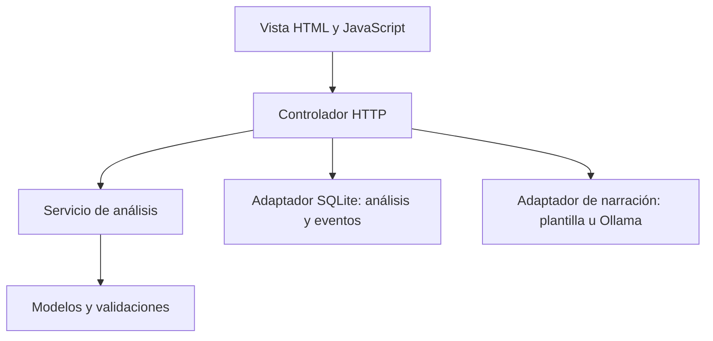

# Arquitectura y decisiones
Monolito modular MVC con servicios y adaptadores. Python 3.12, HTTP y SQLite estándar, sin dependencias de runtime.

Las reglas entregan findings con id, severidad, código, mensaje y fuente. El narrador recibe ese resultado; no lo modifica.
SQLite registra cada ejecución y la revisión en una transacción. Una segunda revisión se rechaza; analizar dos veces crea dos ejecuciones distintas.
La acción «revisado» acredita seguimiento, no liberación sanitaria, aceptación física ni movimiento de inventario.

## Harness thinking
- Contexto: README, AGENTS y esta decisión de arquitectura.
- Contratos: entrada JSON validada, resultados estables y fuentes por hallazgo.
- Entorno reproducible: muestra fija con fecha explícita, Python estándar y Docker.
- Evaluaciones: golden dataset, pruebas HTTP, persistencia y límites.
- Control de IA: prompt versionado, esquema de respuesta, fuentes permitidas, timeout y fallback.
- Observabilidad: latencia total, modo IA, versión de reglas y eventos de revisión.

La validación de ids prueba que las referencias existen, no la veracidad semántica de cada frase. Evaluar groundedness con revisión humana antes de usar un modelo en operación.
Demo para localhost, sin autenticación. Para producción: identidad, roles, HTTPS, respaldos, retención, control de archivos, cola de trabajos e integración al ERP.
